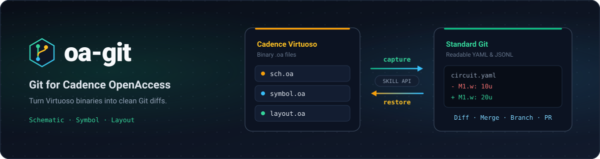
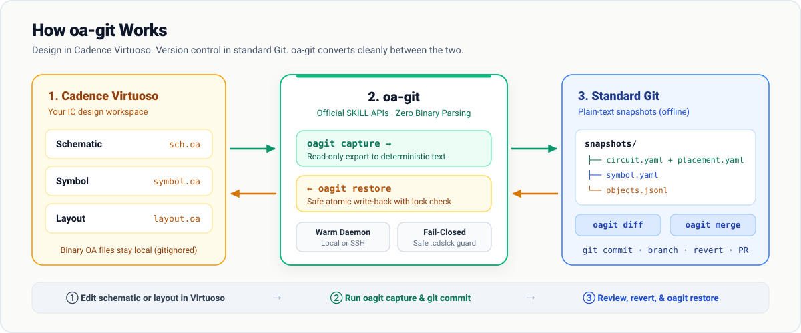

<p align="center">
  
</p>

<p align="center">
  <a href="https://github.com/wsunskyr/oa-git/releases/latest"></a>
  <a href="https://github.com/wsunskyr/oa-git/actions/workflows/ci.yml"></a>
  <a href="https://github.com/wsunskyr/oa-git/stargazers"></a>
  <a href="https://github.com/wsunskyr/oa-git/issues"></a>
  <a href="LICENSE"></a>
  
</p>

<p align="center">
  <a href="docs/ARCHITECTURE.md">Architecture</a>
  &nbsp;·&nbsp; <a href="docs/SYMBOL.md">Symbol</a>
  &nbsp;·&nbsp; <a href="docs/LAYOUT.md">Layout</a>
  &nbsp;·&nbsp; <a href="docs/DAEMON.md">Daemon &amp; Batch</a>
  &nbsp;·&nbsp; <a href="https://github.com/wsunskyr/oa-git/releases">Releases</a>
</p>

Git-native version control for **Cadence OpenAccess** (`sch.oa`, `symbol.oa`, and `layout.oa`) — turning Virtuoso binary databases into deterministic, human-readable `YAML` / `JSONL` snapshots using **official documented SKILL APIs only**.

```bash
# Install from GitHub (or download the offline .whl from Releases)
pip install git+https://github.com/wsunskyr/oa-git.git@v0.1.0

# Run inside any Virtuoso working directory containing cds.lib
oagit init                                                          # git init + safe .gitignore + cds.lib discovery
oagit capture my_lib/opamp/schematic my_lib/opamp/symbol my_lib/opamp/layout
git add snapshots/ .gitignore .oagit/config.json && git commit -m "feat: initial baseline"
```

> **Python >= 3.11 required.** On RHEL/Rocky or EDA servers where default `python3` on `PATH` is older (e.g., 3.8/3.9 from system packages or EDA toolchains), create an isolated environment with `python3.12 -m venv .venv` or [`uv`](https://docs.astral.sh/uv/) (`uv venv --python 3.12 --seed .venv`), install inside `.venv`, and optionally symlink `.venv/bin/oagit` into `~/.local/bin/oagit`.

## How It Works

<p align="center">
  
</p>

- **Minimal 7-Command CLI + Native Git**: Only `init`, `status`, `capture`, `diff`, `merge`, `restore`, and `daemon` — all commits, branches, PR reviews, and reverts stay on standard `git`.
- **Domain-Separated Diff & 3-Way Merge**: Separates electrical/connectivity truth from placement/routing geometry, guards coupled CDF parameters, and blocks overlapping same-layer layout merges.
- **Fail-Closed & Fast**: Blocks unsaved buffers, live `*.cdslck` locks, and non-allowlisted libraries; restores atomically via draft-and-publish with readback verification. Local dirty index skips unchanged views in `< 0.2s`, and a lazy headless daemon stays warm for 1 hour by default (`idle_timeout_s = 3600`, local or SSH).

## Everyday Commands

```bash
oagit status                         # verify snapshots, dirty index, OA locks, and .gitignore health
oagit capture                        # incremental sync (--changed across all tracked views)
oagit capture my_lib/top/schematic --hier --include-symbols
oagit diff HEAD~1..HEAD --stat       # semantic diff across schematic, symbol, and layout
oagit diff --electrical-only         # ignore pure placement / wire tidying
oagit diff --connectivity-only       # layout net / pin / PCell / via changes only
oagit restore my_lib/opamp/schematic --target my_lib/opamp/schematic --overwrite
oagit init --sync                    # refresh config & .gitignore after adding new OA libraries
```

*(For remote Virtuoso servers over SSH, pass `--ssh-host <alias> --cds-lib /path/to/cds.lib` to `oagit init`. For local development and running the offline test suite, clone the repo and run `pip install -e ".[dev]" && pytest`.)*

## Documentation

- [Architecture & CLI Contract](docs/ARCHITECTURE.md)
- [Symbol Reference (`symbol.yaml`)](docs/SYMBOL.md)
- [Physical Layout Reference (`objects.jsonl`)](docs/LAYOUT.md)
- [Headless Daemon, Dirty Index & Batch Spool](docs/DAEMON.md)

## License

MIT ([LICENSE](LICENSE)) — clean-room implementation using official documented Cadence Virtuoso SKILL APIs only.
